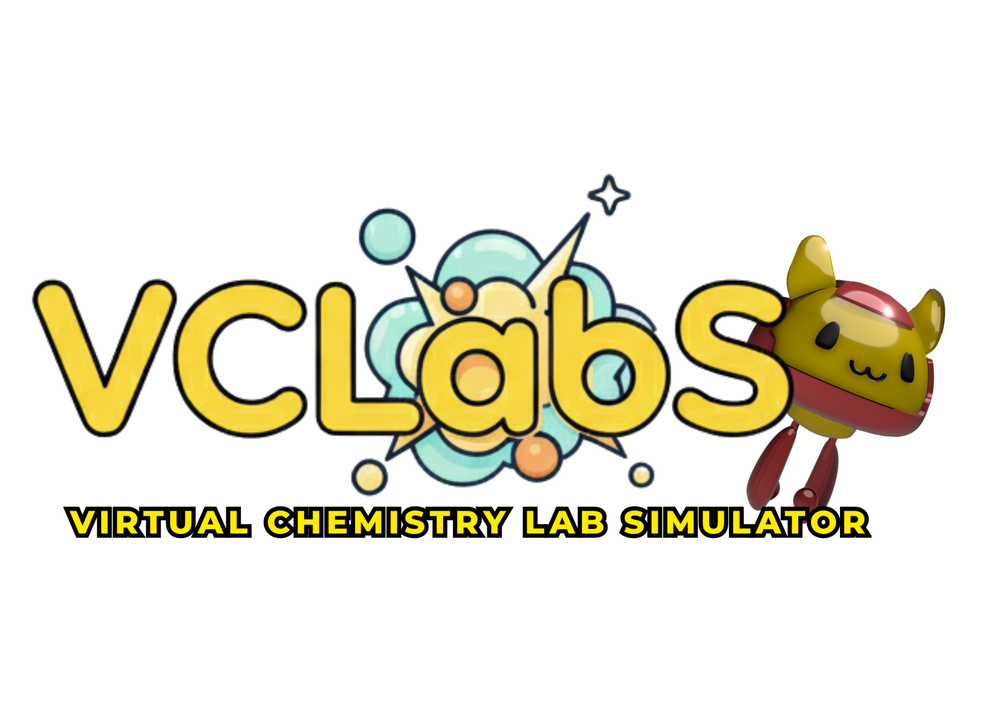

  

# VCLabS — Virtual Chemistry Lab Simulator

VCLabS is a 3D exploration game designed to help secondary school students learn basic chemistry through exploration, guided experiments, apparatus discovery, tutorials, and quizzes.

## Project spaces

- **Main Lobby** — central navigation hub
- **Tutorial Room** — introduces the virtual laboratory
- **Experiment Room** — supports guided chemistry activities
- **Apparatus Room** — presents laboratory equipment
- **Quiz Game Room** — reinforces learning through questions

## Interactive showcase

This repository includes a browser-based 3D showcase of the VCLabS environments. Visitors can select rooms, rotate the models, zoom, pan, and open the viewer fullscreen.

The showcase models were exported from Shapr3D in GLB format. This website presents the environments; it does not include the original game's playable experiments, movement system, or quiz scoring.
